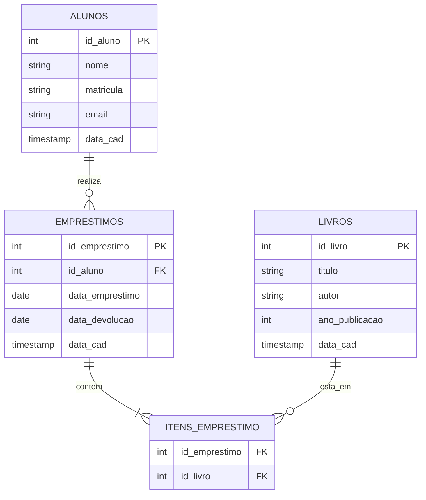

# Documentação do Banco de Dados - Biblioteca

## 1. Diagrama Entidade-Relacionamento (DER)

---

## 2. Dicionário de Dados

### Tabela: alunos
| Campo | Tipo | Nulo | Chave | Padrão | Descrição |
|---|---|---|---|---|---|
| `id_aluno` | INT | Não | PK | Auto | Identificador único do aluno |
| `nome` | VARCHAR(100) | Não | - | - | Nome completo do aluno |
| `matricula` | VARCHAR(20) | Não | UNIQUE | - | Matrícula única do aluno |
| `email` | VARCHAR(150) | Sim | - | NULL | E-mail de contato |
| `data_cad` | TIMESTAMP | Não | - | CURRENT_TIMESTAMP | Data/hora do cadastro |

### Tabela: livros
| Campo | Tipo | Nulo | Chave | Padrão | Descrição |
|---|---|---|---|---|---|
| `id_livro` | INT | Não | PK | Auto | Identificador único do livro |
| `titulo` | VARCHAR(150) | Não | - | - | Título da obra |
| `autor` | VARCHAR(100) | Não | - | - | Autor do livro |
| `ano_publicacao` | YEAR | Não | - | - | Ano de publicação |
| `data_cad` | TIMESTAMP | Não | - | CURRENT_TIMESTAMP | Data/hora do cadastro |

### Tabela: emprestimos
| Campo | Tipo | Nulo | Chave | Padrão | Descrição |
|---|---|---|---|---|---|
| `id_emprestimo` | INT | Não | PK | Auto | Identificador único do empréstimo |
| `id_aluno` | INT | Não | FK | - | Código do aluno (referência `alunos`) |
| `data_emprestimo` | DATE | Não | - | - | Data em que o livro foi retirado |
| `data_devolucao` | DATE | Sim | - | NULL | Data de devolução (NULL se em aberto) |
| `data_cad` | TIMESTAMP | Não | - | CURRENT_TIMESTAMP | Data/hora do registro |

### Tabela: itens_emprestimo
| Campo | Tipo | Nulo | Chave | Padrão | Descrição |
|---|---|---|---|---|---|
| `id_emprestimo` | INT | Não | FK | - | Código do empréstimo (referência `emprestimos`) |
| `id_livro` | INT | Não | FK | - | Código do livro (referência `livros`) |